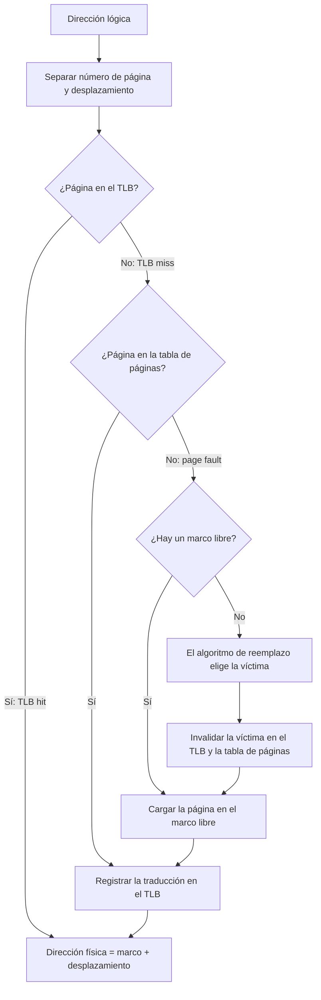
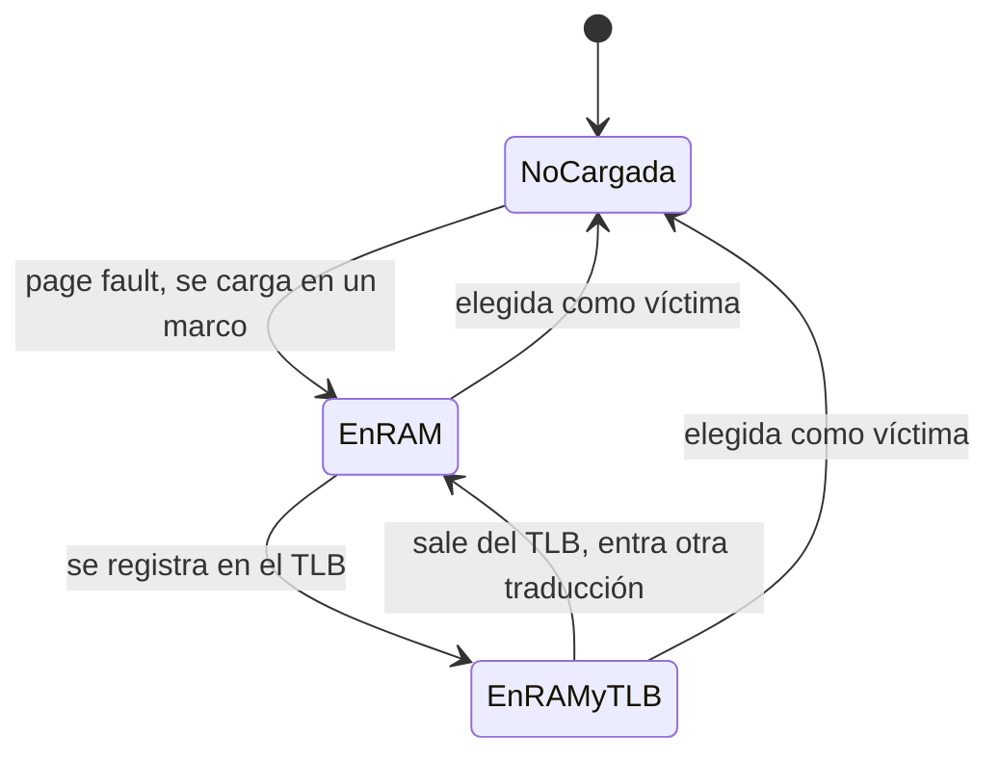
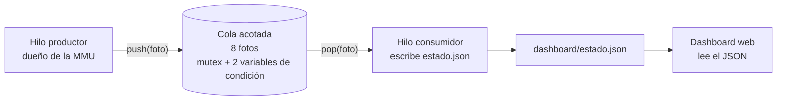
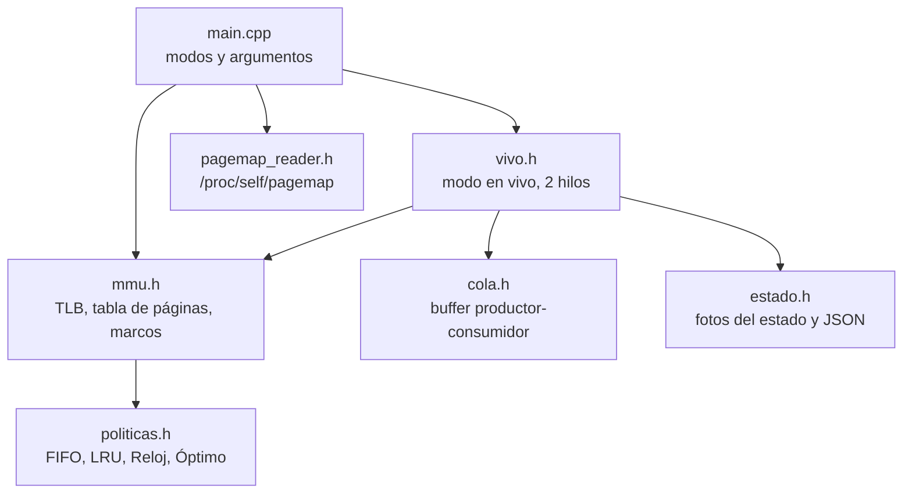

# Virtual MMU Page Replace Explorer

Simulador de memoria virtual en **C++**: traduce direcciones lógicas a físicas con **TLB** y **tabla de páginas**, aplica algoritmos de reemplazo de páginas (**FIFO, LRU, Reloj y Óptimo**), demuestra la **Anomalía de Belady**, lee datos reales del kernel de Linux (`/proc/self/pagemap`) y muestra los resultados en un **dashboard web** que se actualiza en tiempo real.

Proyecto de la asignatura Sistemas Operativos — Tecnología en Gestión de Sistemas Informáticos, UNINTEP.

## Contenido

1. [Características](#características)
2. [Requisitos](#requisitos)
3. [Instalación](#instalación)
4. [Compilar](#compilar)
5. [Uso](#uso)
6. [Dashboard](#dashboard)
7. [Arquitectura y diagramas](#arquitectura-y-diagramas)
8. [Estructura del proyecto](#estructura-del-proyecto)
9. [Pruebas de memoria](#pruebas-de-memoria)
10. [Problemas frecuentes](#problemas-frecuentes)
11. [Limitaciones y mejoras futuras](#limitaciones-y-mejoras-futuras)
12. [Equipo](#equipo)

## Características

- **MMU simulada:** separa página y desplazamiento, consulta el TLB, luego la tabla de páginas y, si la RAM está llena, dispara el algoritmo de reemplazo.
- **4 algoritmos intercambiables:** FIFO, LRU (lista + mapa, O(1)), Reloj (bit de referencia y puntero circular) y Óptimo (métrica de control).
- **Métricas:** page faults, hits y misses del TLB.
- **Anomalía de Belady:** tabla de fallos con 1 a 7 marcos.
- **Interacción con el kernel:** lectura de `/proc/self/pagemap` con `open`, `pread` y `mmap`, con manejo de errores y sin fugas de memoria.
- **Concurrencia:** modelo productor-consumidor con `std::thread` (hilos POSIX en Linux), `std::mutex` y variables de condición.
- **Dashboard:** mapa de marcos, panel del TLB y gráfica de fallos contra marcos.

## Requisitos

| Requisito | Detalle |
|---|---|
| Sistema operativo | **Linux** (probado en Ubuntu). `/proc/PID/pagemap` no existe en Windows ni macOS |
| Compilador | `g++` con C++17 (`build-essential`) |
| Python 3 | Solo para `servidor.py` (servidor local del dashboard) |
| Navegador | Firefox, Chrome o similar |
| Git | Para clonar el proyecto |
| Valgrind | Opcional, para repetir las pruebas de memoria |

> **¿Usas Windows?** Instala una máquina virtual (VMware o VirtualBox) con Ubuntu, con 4 GB de RAM y 40 GB de disco, o usa WSL2 con Ubuntu.

## Instalación

```bash
sudo apt update
sudo apt install build-essential git python3 valgrind

git clone https://github.com/DanielaBG77/virtual-mmu-page-replace-explorer.git
cd virtual-mmu-page-replace-explorer
```

## Compilar

```bash
g++ -std=c++17 -Wall -Wextra -pthread -o simulador src/main.cpp
```

La opción `-pthread` es obligatoria porque el proyecto usa hilos.

## Uso

```bash
./simulador <archivo> <marcos> <modo> [opciones]
```

| Comando | Qué hace |
|---|---|
| `./simulador pruebas/secuencia.txt 3` | Compara los 4 algoritmos con 3 marcos |
| `./simulador pruebas/secuencia.txt 3 lru` | Traza detallada de un algoritmo (`fifo`, `lru`, `reloj`, `optimo`) |
| `./simulador pruebas/secuencia.txt 3 lru 8` | Igual, con un TLB de 8 entradas (por defecto 4) |
| `./simulador pruebas/secuencia.txt 3 belady` | Tabla de fallos con 1 a 7 marcos y genera `dashboard/belady.json` |
| `./simulador pruebas/secuencia.txt 3 pagemap` | Lectura real de `/proc/self/pagemap` (repetir con `sudo` para ver los marcos físicos) |
| `./simulador pruebas/secuencia.txt 3 vivo lru 700` | Simulación en vivo con pausa de 700 ms por paso; publica `dashboard/estado.json` |

### Resultados esperados con `secuencia.txt`

| Marcos | FIFO | LRU | Reloj | Óptimo |
|---|---|---|---|---|
| 3 | 9 | 10 | 9 | 7 |
| 4 | 10 | 8 | 10 | 6 |

Con FIFO, pasar de 3 a 4 marcos **aumenta** los fallos de 9 a 10: es la **Anomalía de Belady**. Con esta secuencia, Reloj también la muestra (9 a 10), mientras que LRU y Óptimo bajan sus fallos al agregar memoria.

### Secuencia propia

El archivo de entrada es un `.txt` con números de página separados por espacios:

```
1 2 3 4 1 2 5 1 2 3 4 5
```

## Dashboard

Basta **una terminal**:

1. En la raíz del proyecto (ya compilado): `python3 servidor.py` (dejarla abierta)
2. Abrir en el navegador `http://localhost:8000`
3. Elegir secuencia, marcos, algoritmo y pausa, y pulsar **▶ Ejecutar**

El selector de algoritmo permite correr uno solo (FIFO, LRU, Reloj, Óptimo) o **Todos (comparar los 4)**, que ejecuta los cuatro a la vez y los muestra juntos en el mapa de marcos, la tabla del TLB y las gráficas.

Para apagar el servidor: `Ctrl + C` (también detiene las simulaciones en curso). Los datos de cada corrida se guardan en `.vivo/`, que está en `.gitignore`.

## Arquitectura y diagramas

### Flujo de un acceso a memoria (MMU)



### Ciclo de vida de una página



### Modo en vivo: productor-consumidor



El productor espera si la cola está llena (`noLlena`) y el consumidor espera si está vacía (`noVacia`), sin consumir CPU. El `mutex` garantiza que solo un hilo modifique la cola a la vez, lo que evita condiciones de carrera. El JSON se escribe de forma atómica para que el dashboard nunca lea un archivo a medias.

### Módulos del código



## Estructura del proyecto

```
virtual-mmu-page-replace-explorer/
├── src/
│   ├── main.cpp            # modos y argumentos
│   ├── mmu.h               # MMU: TLB, tabla de páginas, marcos, métricas
│   ├── politicas.h         # FIFO, LRU, Reloj, Óptimo
│   ├── pagemap_reader.h    # lectura de /proc/self/pagemap
│   ├── cola.h              # buffer productor-consumidor
│   ├── estado.h            # fotos del estado y JSON
│   └── vivo.h              # modo en vivo con dos hilos
├── pruebas/
│   └── secuencia.txt
├── dashboard/
│   ├── index.html
│   └── belady.json
├── servidor.py             # servidor local del dashboard
└── README.md
```

## Pruebas de memoria

```bash
g++ -std=c++17 -Wall -Wextra -g -pthread -o simulador src/main.cpp
valgrind --leak-check=full ./simulador pruebas/secuencia.txt 3 vivo lru 0
valgrind --leak-check=full ./simulador pruebas/secuencia.txt 3 pagemap
```

Resultado esperado: `All heap blocks were freed -- no leaks are possible` y `ERROR SUMMARY: 0 errors`.

## Problemas frecuentes

| Síntoma | Solución |
|---|---|
| `fatal error: cola.h: No such file or directory` | Falta un archivo en `src`; verificar con `ls src` |
| `undefined reference to pthread_create` | Compilar con `-pthread` |
| `Error: la secuencia esta vacia` | El `.txt` está vacío o sin guardar |
| `Error: no se pudo abrir ...` | Ejecutar desde la raíz del proyecto |
| Marco físico `(oculto: requiere sudo)` | Normal sin permisos; ejecutar con `sudo` |
| Dashboard en "Esperando estado.json..." | Pulsar **▶ Ejecutar** y verificar que `python3 servidor.py` corre desde la raíz |
| Gráfica vacía | Pulsar **▶ Ejecutar** (genera `belady.json`) |
| Falta la opción «Todos» / dos botones | `index.html` antiguo: reemplazarlo y `Ctrl + Shift + R` |
| `Address already in use` | Otro servidor usa el puerto 8000: `python3 servidor.py 8001` |
| Cambios en la página no se ven | Recargar con `Ctrl + Shift + R` |
| `Permission denied` al ejecutar `./simulador` | `chmod +x simulador` o volver a compilar |

## Limitaciones y mejoras futuras

**Limitaciones**

- Modela un solo proceso con una única tabla de páginas.
- El desplazamiento de las direcciones lógicas es sintético cuando la entrada es un archivo de páginas.
- El Swap es conceptual: no se simulan bits de modificación ni escrituras a disco.
- La lectura de `pagemap` es demostrativa y no alimenta la simulación.

**Mejoras futuras**

- **Gráfica "Page Faults vs. marcos asignados":** hoy, en cada ejecución, la gráfica anterior solo se opaca y los marcadores la recorren encima. La mejora prevista es borrarla por completo y redibujarla desde cero en cada **Ejecutar**, para que no se mezclen los datos de una corrida con los de la anterior.

## Equipo

- Daniela Blandón García
- Alex Raúl Japote
